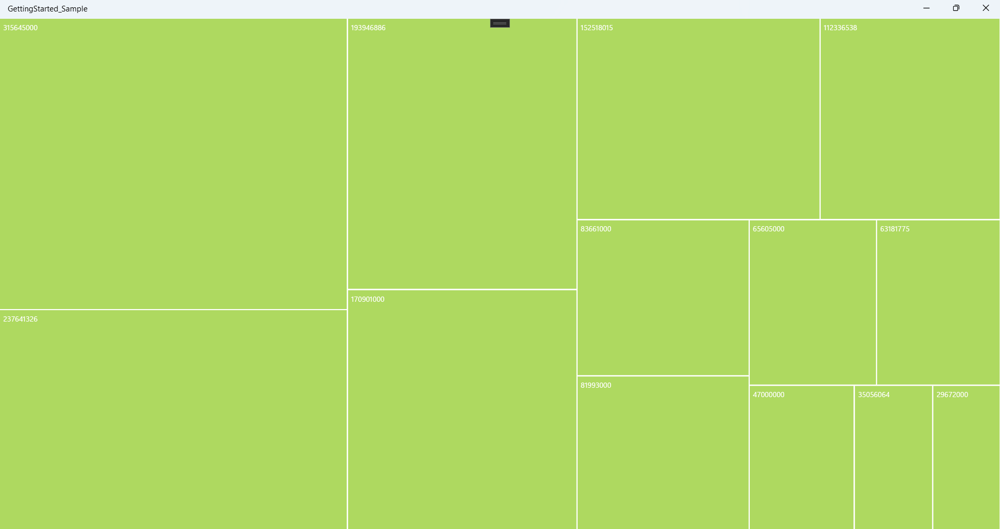

# Getting Started with UWP TreeMap (SfTreeMap)

This sample demonstrates how to create a UWP TreeMap using the Syncfusion `SfTreeMap` control.

## Prerequisites

- Visual Studio 2022 or later
- Windows 10 SDK (10.0.16299.0 or later)
- [Syncfusion.SfTreeMap.UWP](https://www.nuget.org/packages/Syncfusion.SfTreeMap.UWP) NuGet package (latest)

## Adding Assembly Reference

### Option 1: Via NuGet Package Manager

1. Right-click on the project in **Solution Explorer** and select **Manage NuGet Packages**.
2. Search for `Syncfusion.SfTreeMap.UWP` and install it.

### Option 2: Via Extension Reference

1. Open the **Add Reference** window from your project.
2. Choose **Windows > Extensions > Syncfusion Controls for UWP XAML**.

## Adding Namespace

After adding the reference, include the following namespace in your `MainPage.xaml`:

```xml
xmlns:syncfusion="using:Syncfusion.UI.Xaml.TreeMap"
```

## Creating the Data Model for TreeMap

Create a `PopulationDetail` model class (`Model/PopulationDetail.cs`) to hold the data:

```csharp
namespace GettingStarted_Sample
{
    public class PopulationDetail
    {
        public string Continent { get; set; }
        public string Country { get; set; }
        public double Growth { get; set; }
        public double Population { get; set; }
    }
}
```

## Creating the ViewModel for TreeMap

Create a `PopulationViewModel` class (`ViewModel/PopulationViewModel.cs`) with sample data:

```csharp
using System.Collections.ObjectModel;

namespace GettingStarted_Sample
{
    public class PopulationViewModel
    {
         public PopulationViewModel()
        {
            this.PopulationDetails = new ObservableCollection<PopulationDetail>();
            PopulationDetails.Add(new PopulationDetail() { Continent = "Asia", Country = "Indonesia", Growth = 3, Population = 237641326 });
            PopulationDetails.Add(new PopulationDetail() { Continent = "Asia", Country = "Russia", Growth = 2, Population = 152518015 });
            PopulationDetails.Add(new PopulationDetail() { Continent = "Asia", Country = "Malaysia", Growth = 1, Population = 29672000 });
            PopulationDetails.Add(new PopulationDetail() { Continent = "North America", Country = "United States", Growth = 4, Population = 315645000 });
            PopulationDetails.Add(new PopulationDetail() { Continent = "North America", Country = "Mexico", Growth = 2, Population = 112336538 });
            PopulationDetails.Add(new PopulationDetail() { Continent = "North America", Country = "Canada", Growth = 1, Population = 35056064 });
            PopulationDetails.Add(new PopulationDetail() { Continent = "South America", Country = "Colombia", Growth = 1, Population = 47000000 });
            PopulationDetails.Add(new PopulationDetail() { Continent = "South America", Country = "Brazil", Growth = 3, Population = 193946886 });
            PopulationDetails.Add(new PopulationDetail() { Continent = "Africa", Country = "Nigeria", Growth = 2, Population = 170901000 });
            PopulationDetails.Add(new PopulationDetail() { Continent = "Africa", Country = "Egypt", Growth = 1, Population = 83661000 });
            PopulationDetails.Add(new PopulationDetail() { Continent = "Europe", Country = "Germany", Growth = 1, Population = 81993000 });
            PopulationDetails.Add(new PopulationDetail() { Continent = "Europe", Country = "France", Growth = 1, Population = 65605000 });
            PopulationDetails.Add(new PopulationDetail() { Continent = "Europe", Country = "UK", Growth = 1, Population = 63181775 });
        }

        public ObservableCollection<PopulationDetail> PopulationDetails
        {
            get;
            set;
        }
    }
}
```

## Initializing the TreeMap (XAML)

In `MainPage.xaml`, set the `DataContext` to `PopulationViewModel`, then initialize `SfTreeMap` by binding `ItemsSource` to the data collection and setting `WeightValuePath` to the data property:

```xml
<Page
    x:Class="GettingStarted_Sample.MainPage"
    xmlns="http://schemas.microsoft.com/winfx/2006/xaml/presentation"
    xmlns:x="http://schemas.microsoft.com/winfx/2006/xaml"
    xmlns:local="using:GettingStarted_Sample"
    xmlns:d="http://schemas.microsoft.com/expression/blend/2008"
    xmlns:mc="http://schemas.openxmlformats.org/markup-compatibility/2006"
    xmlns:syncfusion="using:Syncfusion.UI.Xaml.TreeMap"
    mc:Ignorable="d"
    Background="{ThemeResource ApplicationPageBackgroundThemeBrush}">

    <Grid>
        <Grid.DataContext>
            <local:PopulationViewModel/>
        </Grid.DataContext>

        <syncfusion:SfTreeMap ItemsSource="{Binding PopulationDetails}"
                              WeightValuePath="Population">
        </syncfusion:SfTreeMap>
    </Grid>
</Page>
```

## Initializing the TreeMap (Code-Behind)

Alternatively, you can create the TreeMap entirely in C# code-behind:

```csharp
using Syncfusion.UI.Xaml.TreeMap;

// Creating the ViewModel
PopulationViewModel viewModel = new PopulationViewModel();

// Assigning the data context
this.DataContext = viewModel;

// Initializing the TreeMap
SfTreeMap sfTreeMap = new SfTreeMap();

// Setting ItemsSource and WeightValuePath
sfTreeMap.ItemsSource = viewModel.PopulationDetails;
sfTreeMap.WeightValuePath = "Population";

// Adding TreeMap to the Grid
grid.Children.Add(sfTreeMap);
```



## Reference

- [Syncfusion UWP TreeMap Getting Started Documentation](https://help.syncfusion.com/uwp/treemap/getting-started)
